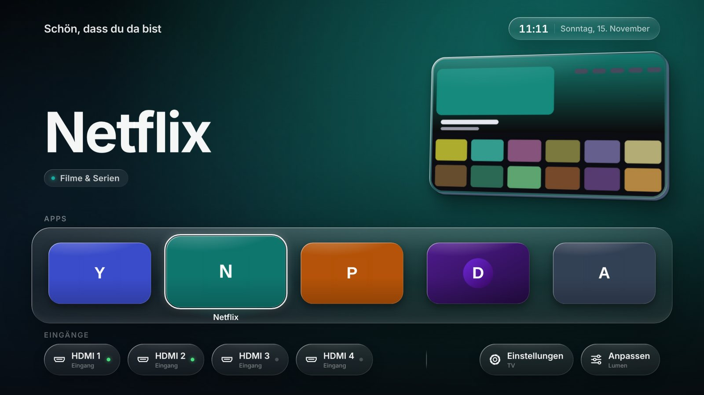
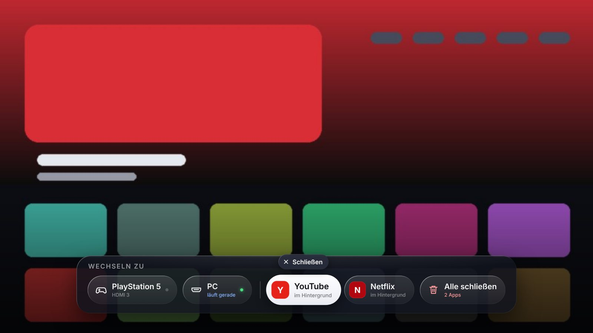
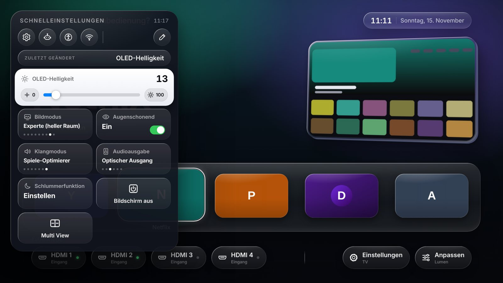
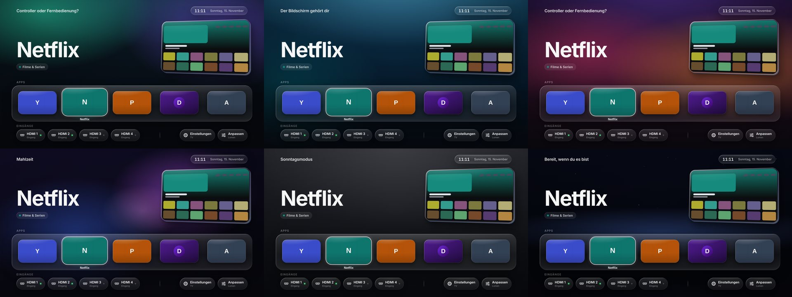

# Lumen für LG webOS

Ein eigenes Hauptmenü für gerootete LG-Fernseher – mit Glas-Design, großer Vorschaukarte,
Eingängen und Apps auf einen Blick. Dazu eine Leiste über dem laufenden Bild für die
Source-Taste, eigene Schnelleinstellungen für die Einstellungen-Taste und ein kleines
Windows-Programm, das alles per Klick auf den Fernseher bringt.

> **Voraussetzung: Der Fernseher muss gerootet sein** (Homebrew Channel mit „Root status: ok“).
> Lumen rootet den Fernseher nicht. Ob deiner sich rooten lässt, hängt von Modell und Firmware ab –
> siehe [Kompatibilität](docs/KOMPATIBILITAET.md) und [CanI.RootMy.TV](https://cani.rootmy.tv/).

## Was drin ist

| Teil | Was es macht |
|---|---|
| **Lumen** (`lumen/`) | Das Hauptmenü: App-Reihe, Eingänge mit Verbunden-Anzeige, Vorschaukarte mit letztem Bildschirm, eigenen Bildern oder HDMI live, Begrüßung, Start-Animation, Hintergründe (App-Farbe, sechs Designs, eigene Bilder), WLED-Licht passend zum Bild, Web-Backend zum Einstellen am Handy oder PC. |
| **Lumen Leiste** (`leiste/`) | Liegt als Overlay über der laufenden App bzw. dem HDMI-Bild. **Source-Taste:** Eingänge und geöffnete Apps zum Wechseln und Schließen. **Einstellungen-Taste:** Schnelleinstellungen (Helligkeit als Regler, Bild- und Klangmodus, Augenschonend, Audioausgabe, Schlummerfunktion, Bildschirm aus, Multi View). |
| **tvclean** (`tvclean/`) | Root-Skripte: Lumen statt webOS-Home starten, Werbung, Tracking und Firmware-Updates sperren, Apps ausblenden, Kurzbefehle für die Tastenbelegung. Alles umkehrbar. |
| **Lumen Installer** (`installer/`) | Windows-Programm: Pakete auswählen, Fernseher suchen, installieren. Update oder Komplettinstallation auf einem neuen Fernseher. |

| Source-Leiste | Schnelleinstellungen |
|---|---|
|  |  |

## Schnellstart

1. Fernseher rooten (siehe [webosbrew.org](https://www.webosbrew.org/rooting)) und im Homebrew Channel den **SSH-Server** einschalten.
2. Unter [Releases](https://github.com/patrickpatr22/lumen-webos/releases/latest) **`Lumen-Komplett.zip`** herunterladen und entpacken.
3. **`Lumen-Installer.exe`** starten → „Neuer Fernseher – Komplettinstallation“ → „Fernseher suchen“ → „Auf den Fernseher installieren“. Im schwarzen Fenster zweimal das Root-Passwort eingeben (Standard: `alpine`).
4. Der Fernseher startet neu. Danach am Fernseher den Einschaltbildschirm auf „Home“ stellen und mit **LG Input Hook** die Tasten belegen.

Alles Weitere, auch die Installation ohne Windows: **[Installation](docs/INSTALLATION.md)**.

## Kompatibilität

Getestet auf einem **LG OLED55B39LA** (B3, 2023, α7 Gen6) mit **webOS 25** (sdkVersion 10.3.2, Firmware 33.31.75).
Erwartet lauffähig ab **webOS 22** (Chromium 87). webOS 6 und älter werden nicht unterstützt.
Die ausführlichen Listen für Software und Hardware: **[docs/KOMPATIBILITAET.md](docs/KOMPATIBILITAET.md)**.

Hast du Lumen auf einem anderen Fernseher ausprobiert? Ein [Issue](https://github.com/patrickpatr22/lumen-webos/issues) mit Modell,
webOS-Version und was (nicht) geht hilft, die Liste zu vervollständigen.

## Dokumentation

- [Installation](docs/INSTALLATION.md) – Installer, manuelle Installation, Tastenbelegung, Entfernen
- [Kompatibilität](docs/KOMPATIBILITAET.md) – webOS-Versionen und Fernseher
- [Entwicklung](docs/ENTWICKLUNG.md) – Aufbau, Bauen, Tests
- [Änderungen](CHANGELOG.md)
- Einzelheiten je Teil: [Lumen](lumen/README.md) · [Lumen Leiste](leiste/README.md) · [tvclean](tvclean/README.md) · [Installer](installer/README.md)

## Hinweise

- Lumen ist ein privates Projekt und hat nichts mit LG Electronics zu tun. „LG“, „webOS“ und „Magic Remote“ sind Marken von LG Electronics.
- Rooten und Eingriffe ins System geschehen auf eigene Gefahr. Firmware-Updates können den Root-Zugang entfernen – tvclean sperrt sie deshalb.
- Die Oberfläche ist auf Deutsch.

## English summary

Lumen is a custom home screen for **rooted** LG webOS TVs (Homebrew Channel required), with an overlay
bar for the Source key, a quick-settings panel for the Settings key, root scripts that replace the webOS
home screen and block ads/tracking/firmware updates, and a small Windows installer. Tested on an LG
OLED55B39LA running webOS 25; expected to work on webOS 22 and newer. The UI is German only.
See [docs/KOMPATIBILITAET.md](docs/KOMPATIBILITAET.md) for the compatibility lists.

## Lizenz

[MIT](LICENSE). Schrift: Inter (SIL Open Font License).
